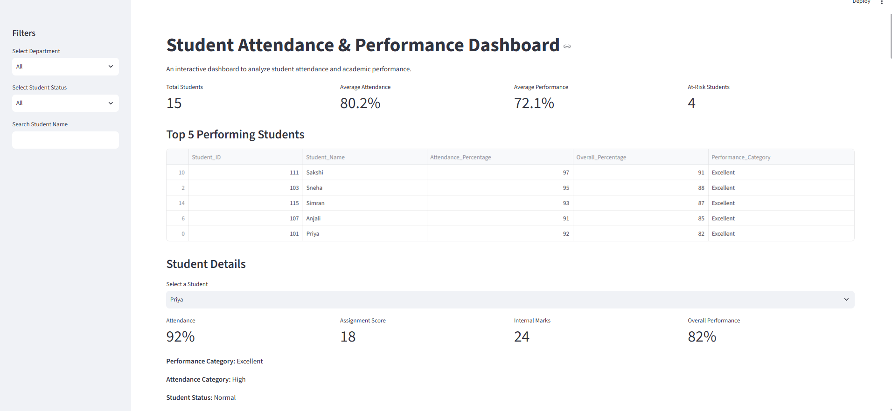
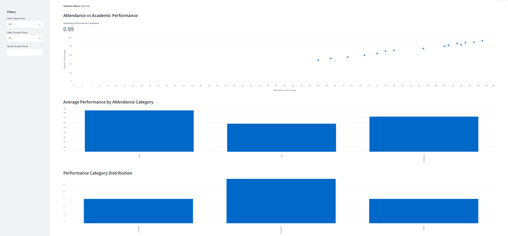
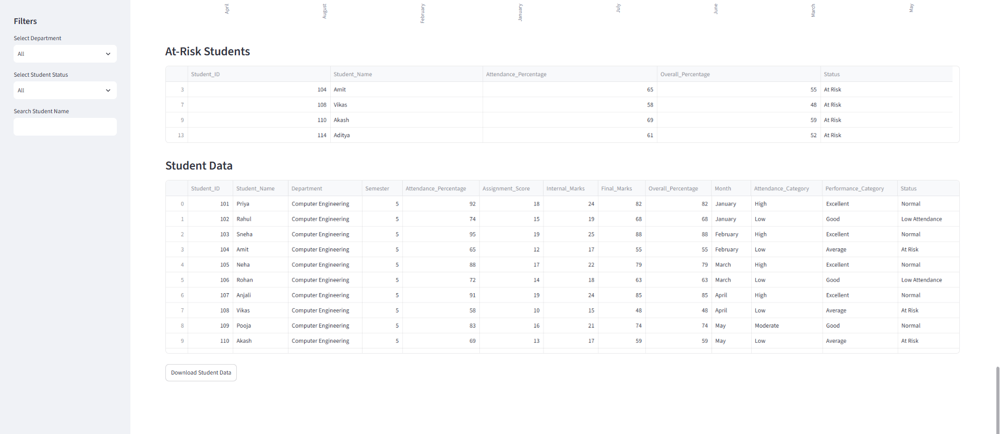

# Student Attendance & Performance Dashboard

An interactive data analysis and visualization dashboard built using Python, Pandas, NumPy, Matplotlib, and Streamlit to analyze student attendance and academic performance.

## Live Demo

**Live Application:** [Student Attendance & Performance Dashboard](https://student-attendence-and-performance-correlation-dashboard-jmwtn.streamlit.app/)

Explore student attendance, academic performance, interactive visualizations, and at-risk student analysis directly in your browser.

## Project Overview

The Student Attendance & Performance Dashboard analyzes student attendance, assignment scores, internal marks, and overall academic performance.

The project uses data preprocessing, statistical analysis, correlation analysis, and data visualization to identify performance patterns and students who may require additional academic attention.

## Objectives

- Analyze student attendance and academic performance.
- Study the relationship between attendance and overall performance.
- Categorize students based on attendance and performance.
- Identify students who may be at risk academically.
- Compare attendance and performance across different months.
- Provide an interactive dashboard for exploring student data.

## Technologies Used

- Python
- NumPy
- Pandas
- Matplotlib
- Streamlit
- CSV Data Handling

## Key Features

- Interactive KPI cards
- Student name search
- Department and student status filtering
- Top five performing students
- Individual student performance details
- Attendance versus academic performance analysis
- Attendance-performance correlation analysis
- Performance and attendance category distributions
- Performance percentage pie chart
- Monthly attendance and performance comparisons
- At-risk student identification
- Complete student data table
- Download filtered student data as CSV

## Data Analysis

- Data loading and processing using Pandas
- Data inspection and preprocessing
- Missing-value detection
- Attendance and performance categorization
- Statistical and correlation analysis
- Grouping and aggregation
- Monthly performance analysis
- Student risk identification

## Project Structure

```text
Student-Attendence-and-Performance-Correlation-Dashboard/
├── data/
│   ├── student_data.csv
│   └── processed_student_data.csv
├── charts/
├── screenshots/
│   ├── dashboard.png
│   ├── analytics.png
│   └── risk.png
├── analysis.py
├── dashboard.py
├── requirements.txt
└── README.md
```

## Dashboard

The Streamlit dashboard provides an interactive interface for analyzing student data. Users can filter students, search for individual records, explore performance relationships, compare monthly trends, identify at-risk students, and download filtered data.

## Project Demonstration

Watch the project demonstration on YouTube:

[Student Attendance & Performance Dashboard Demo](https://youtu.be/ZM9gi02OU7E)

## Dashboard Screenshots

### Dashboard Overview



### Analytics and Visualizations



### At-Risk Students and Student Data



## Key Insight

The analysis of the sample dataset shows a strong positive relationship between student attendance and overall academic performance. The dashboard also helps identify students with lower attendance and academic performance who may require additional academic support.

## Installation and Setup

### 1. Clone the Repository

```bash
git clone https://github.com/mangaonkarpriyada-code/Student-Attendence-and-Performance-Correlation-Dashboard.git
```

### 2. Navigate to the Project Directory

```bash
cd Student-Attendence-and-Performance-Correlation-Dashboard
```

### 3. Install Required Libraries

```bash
pip install -r requirements.txt
```

### 4. Run the Dashboard

```bash
python -m streamlit run dashboard.py
```

The dashboard will open in your default web browser.

## Requirements

The project uses the following Python libraries:

- pandas
- numpy
- matplotlib
- streamlit

All dependencies are listed in `requirements.txt`.

## Future Enhancements

- Integrate larger, real-world datasets.
- Add authentication and role-based access.
- Introduce predictive analytics for student performance.
- Add downloadable analytical reports.
- Expand interactive data visualizations.

## Author

**Priyada Mangaonkar**

Computer Engineering Student

GitHub: [mangaonkarpriyada-code](https://github.com/mangaonkarpriyada-code)
